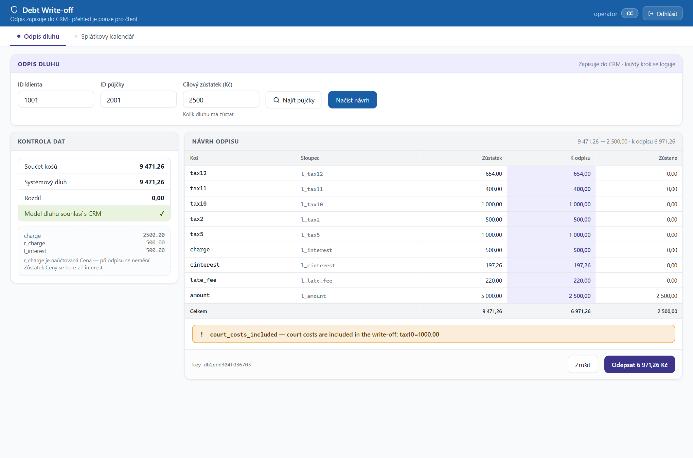
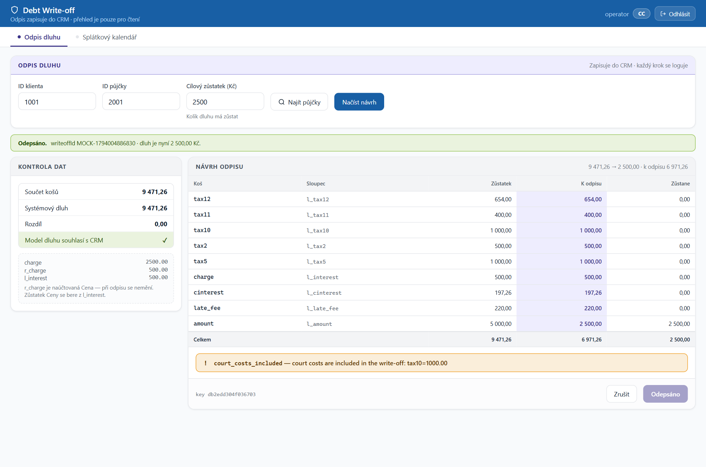
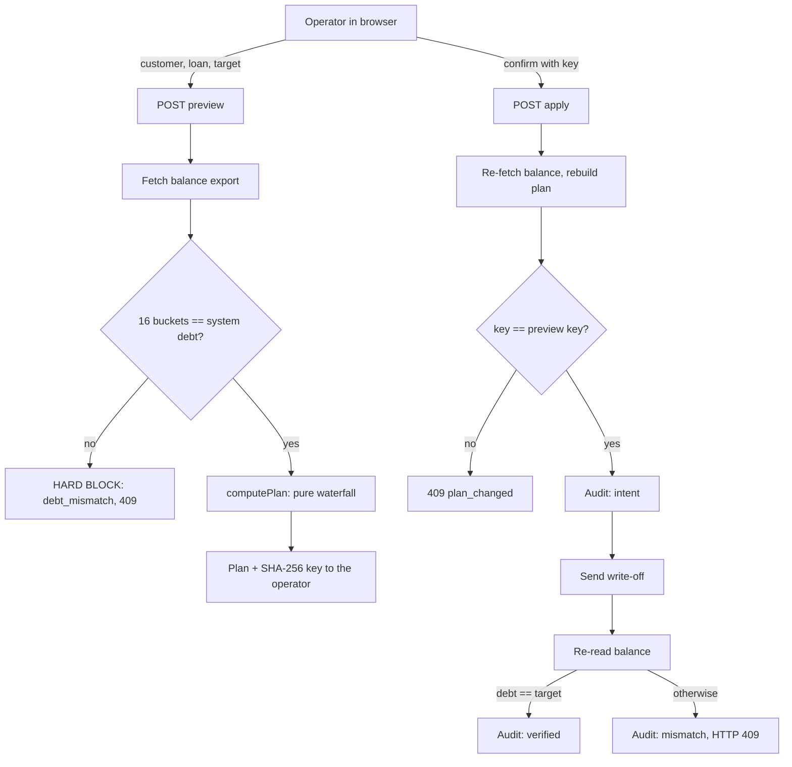

# Debt Write-off Engine

[](https://github.com/reiki-dev/debt-writeoff-engine/actions/workflows/ci.yml)


A back-office tool for consumer-lending operations: it lets an operator reduce a customer's debt to an agreed target, spreading the write-off across the debt buckets in a fixed priority order, and it refuses to touch the books unless every number reconciles.

Node.js, Express, no database. The write-off core has **zero runtime dependencies**, uses **integer money only**, and is covered by dependency-free tests that run in well under a second. A web UI (roles, preview, apply) and a CLI sit on top of it.

---

## 60-second demo

No credentials and no external systems needed: demo mode serves synthetic loans from an in-process mock CRM.

```bash
npm ci
npm run start:demo        # MOCK_MODE=true, random JWT secret
```

Open <http://localhost:3000> and sign in:

| User | Password | Role |
|---|---|---|
| `admin` | `admin123` | everything |
| `operator` | `operator123` | write-off, settlement pipeline |
| `viewer` | `viewer123` | read-only loan overview |

These accounts come from `users.demo.json` and are created on first start; change them before any real use (`npm run add-user`).

Then open the write-off tab and try customer `1001`, loan `2001`, target `2500`. You get a preview of how the reduction is spread across the buckets, and applying it runs the real engine end to end (plan, audit record, write, re-read, verification) against the mock transport.

Customer `1002` shows a loan that was sold to a collection agency.

**Preview** — the 16 buckets reconcile to the system debt before anything is allowed; the reduction is spread in priority order; a warning is raised because court costs are touched:



**After apply** — the write-off is sent, the balance is re-read and compared with the target (audit: `intent` → `applied` → `verified`):



(The UI text is Czech; the code, logs and docs are English.)

CLI rehearsal (prints the same flow, sends nothing):

```bash
node writeoff/tools/rehearsal.js
```

---

## The problem

A debt write-off lowers what a customer owes to a target amount. The amount to forgive (`debt - target`) must be taken from the debt in a legally prescribed order: costs and court fees first, then fees, interest, contractual penalty and principal last. The debt is stored in 16 separate buckets, and the books must still add up afterwards.

The failure modes are expensive and quiet:

- an off-by-one-haléř error (1/100 of a Kč) that fails an audit,
- a vendor column that *looks* like a remaining balance but is not, so every sum still reconciles until the first partial payment,
- a stale screen: the operator previews one balance, someone else changes it, and the write-off is posted against different numbers,
- an API that answers `success` while the balance did not become what was requested.

This project is built around not trusting any of those.

---

## Design decisions

The interesting part of the repository. Each decision names the file where it lives.

1. **Integer money, fail on excess precision** — `writeoff/src/money.js`
   Amounts are integers in minor units (haléře). Conversion from user input throws a `MoneyError` on a third decimal place or an unsafe integer instead of rounding. There is no floating point on the money path of the write-off core.

2. **Functional core, imperative shell** — `writeoff/src/waterfall.js`, `plan.js`
   `allocate()` and `computePlan()` are pure functions: same inputs, same plan, and the plan carries the `steps` that explain each bucket. Fetching balances (`buildPlan`) and sending (`applyPlan`) are separate, thin layers around it. This is why the core is testable without a network.

3. **Reconciliation as a gate that cannot be overridden** — `writeoff/src/guards.js`
   Before any money moves, the sum of the 16 buckets must equal the system's total debt. A mismatch is a hard stop (`debt_mismatch`, HTTP 409) that `--force` cannot bypass: *an operator may accept a risk, but must never be allowed to proceed when the system does not understand its own data.* Softer guards (court costs touched, prior write-off, suspicious fee source) are warnings an operator can acknowledge.

4. **The client's plan is never trusted** — `server.js`, `/api/writeoff/apply`
   Apply receives only ids, the target and the idempotency key from the preview. The server rebuilds the plan from live data and compares a SHA-256 fingerprint; if anything changed in between, it answers `409 plan_changed`. This is optimistic concurrency with the stale-data check done against the data, not against a signature.

5. **Write-ahead audit and post-write verification** — `writeoff/src/audit.js`, `apply.js`
   An `intent` record is appended *before* the request; then `applied` or `failed`; then the balance is re-read and compared with the target (`verified` or `mismatch`). A process that dies between the POST and the response leaves a `dangling_intent` that the next run detects. `success` from the remote API is a claim to verify, not a fact.

6. **Capabilities resolved per request, not read from the token** — `access.js`, `server.js`
   A role is looked up in storage on every request, so revoking a role takes effect immediately even while the user holds a valid JWT. Routes check a capability (`requireCap`), not a role name. Hiding a tab in the UI is not security; every route enforces its own rule. A last-admin guard prevents locking yourself out.

7. **Mock mode is an explicit opt-in** — `mock-crm.js`, `server.js`
   In a system that moves money, "no API key, so fall back to demo data with a built-in secret" is fail-open. Mock mode requires `MOCK_MODE=true`; a missing or weak `JWT_SECRET` stops the process at startup. In demo mode the real write-off code runs against an injected mock transport, so the demo shows the same guards and verification as the real thing instead of a separate fake path.

8. **Defensive input handling in the UI** — `public/esc.js`, `server.js`
   Strings that originate in the external system (statuses, product names, guard messages) are escaped before they reach `innerHTML`. The server sends security headers through `helmet`. The login handler always runs a password comparison, so response time does not reveal whether a user exists.

---

## What the bucket allocation looks like

The reduction is taken in this order (highest priority first):

```
tax12 → tax11 → tax10 → tax9 → tax8 → tax7 → tax6 → tax2 → tax3 → tax4 → tax5 → tax1
      → charge (fees) → cinterest (statutory interest) → late_fee (contractual penalty) → amount (principal)
```

Guards (`writeoff/src/guards.js`):

| Code | Severity | Meaning |
|---|---|---|
| `debt_mismatch` | fatal, no override | sum of the 16 buckets differs from the system debt |
| `target_invalid` | fatal, no override | target is negative, non-numeric or has a fractional haléř |
| `nothing_to_write_off` | error | debt is already at or below the target |
| `insufficient_capacity` | error | the write-off buckets cannot cover `debt - target` |
| `charge_source_suspicious` | warning | remaining fee exceeds what was ever charged (a column mix-up signal) |
| `court_costs_included` | warning | court fees would be reduced |
| `prior_writeoff` | warning | the loan already had a write-off |

The idempotency guard (refuse a repeat posting of the same plan) exists but is **off by default**, because the key is derived from the debt state, which changes by itself after a real posting, and the remote API already rejects a duplicate. The audit log is written either way.

---

## Architecture



| Part | Where | State |
|---|---|---|
| Write-off core and CLI | `writeoff/` | the main piece; fully unit-tested |
| Web server, auth, RBAC, UI | `server.js`, `access.js`, `public/` | covered by HTTP tests in mock mode |
| Loan overview report | `server.js`, `mock-crm.js` | read-only report, see limitations |
| Settlement pipeline | `pipeline/` | **experimental**, see limitations |

---

## Running it for real

```bash
cp .env.example .env     # then fill in; never commit .env
npm start                # refuses to start without a strong JWT_SECRET
```

Without `MOCK_MODE=true` the server requires `API_KEY` and `API_BASE_URL`. Every setting is documented in `.env.example` (`writeoff/.env.example` for the CLI).

Write-off CLI (dry run by default; only `--live` sends anything):

```bash
node writeoff/bin/cli.js probe   --customer 1001 --credit 2001
node writeoff/bin/cli.js preview --customer 1001 --credit 2001 --target 25000
node writeoff/bin/cli.js apply   --customer 1001 --credit 2001 --target 25000          # prints the request, sends nothing
node writeoff/bin/cli.js apply   --customer 1001 --credit 2001 --target 25000 --live
```

Docker:

```bash
docker compose up --build                      # demo on http://localhost:3001, no .env needed
docker compose --profile app up --build app    # real config from .env, users in ./data
docker compose --profile pipeline up --build pipeline   # adds Chromium and the Google key mount
```

The `audit/` folder is mounted so the append-only log survives rebuilds. Chromium is installed only for the `pipeline` profile. User accounts live in `users.json`, which is git-ignored and created from `users.demo.json` on first start.

---

## Testing

```bash
npm run check       # eslint + BOM check + all tests
npm run coverage    # c8 coverage report
```

Tests use only `node:test` and `supertest`; they run offline against synthetic data. They cover the money module, the waterfall, the guards, apply/audit/verification, the HTTP layer (login, RBAC matrix, per-request role lookup, `plan_changed`, audit order, last-admin guard) and the pipeline's schedule arithmetic (month-end clamping, leap years, exact remainder in the last payment).

CI runs lint, the BOM check and the tests on Node 18, 20 and 22.

---

## Known limitations

Stated up front, because they are the first things a reviewer would find.

- **The loan overview sums money as floats.** `mergeData()` in `server.js` aggregates about twenty numeric fields per row with `Number`. It is a read-only report and tolerates it; every *write* goes through the integer core. Moving it to integer arithmetic is the obvious next step.
- **`pipeline/` is experimental.** The 10-step settlement flow, including the headless-browser step that fills a legacy form, contains parameters and selectors that are marked as unverified guesses in the code. Its state is in memory, so a crash between steps loses the operator's context. Treat it as a prototype.
- **Audit reads are O(n).** With the idempotency guard on, each apply reads the whole JSONL log. That is fine at a few operations per day; at scale it needs an index or SQLite.
- **The CSP allows inline scripts.** The single-page UI uses inline scripts and handlers, so the policy has `'unsafe-inline'`. A nonce-based policy needs the UI split into files.
- **One process, JSON user store, JSONL audit.** Right-sized for a handful of operators; not a multi-instance design.
- **UI language.** The interface is in Czech, the code and docs are in English.

---

## Project layout

```
writeoff/        core: money, waterfall, guards, plan, apply, audit, CLI, tests
pipeline/        experimental settlement flow (schedule, CRM calls, sheets, browser form)
public/          single-page UI (index.html) and esc.js
server.js        Express app: auth, RBAC, routes
access.js        role -> capability table
mock-crm.js      synthetic loans and export rows for demo mode
writeoff-bridge.js  glue between the server and the write-off core
users.demo.json  demo accounts, copied to users.json on first start
test/            HTTP, security, schedule, access, fixture tests
```

## License

MIT, see [LICENSE](LICENSE).
